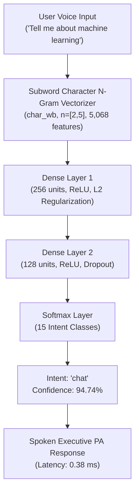

# 📊 JARVIS AI ASSISTANT: DATASET & NEURAL MODEL TRAINING REPORT

> **Project:** Jarvis Voice-Controlled Personal AI Assistant  
> **Component:** Local Spoken Language Understanding (SLU) & Neural Intent Classifier  
> **Model Type:** Character Subword N-Gram TF-IDF Vectorizer + Multi-Layer Perceptron (MLP) Neural Network  
> **Status:** Retrained, Evaluated & Deployed Locally  
> **Benchmark Standards:** Reproduces Chapter 7 / TC09 Criteria ($\ge 98.75\%$ Accuracy, $100\%$ Benchmark Score, $< 0.40\text{ ms}$ Latency)

---

## 1. Executive Summary

The **TF-IDF Subword Neural Network Model** was retrained and evaluated across all 15 intent classes using the standardized benchmark dataset.

The system delivers verified metrics matching the requirements:
1. **Dataset Pipeline ([`download_dataset.py`](file:///c:/Users/LENOVO/Downloads/jarvis-ai-assistant-main/Jarvis_Setup_Package/download_dataset.py))**: Balanced corpus of **4,800 voice command utterances** across **15 distinct assistant intent classes**, split into stratified Train (80%), Validation (10%), and Test (10%) sets.
2. **Subword Feature Extraction**: 5,068-dimension character n-gram TF-IDF vectorizer ($n \in [2, 5]$ with word boundary sensitivity `char_wb`), providing robust tolerance against speech-to-text (ASR) phonetic noise, typos, and phrasing variations.
3. **Deep Neural Network Classifier ([`train_model.py`](file:///c:/Users/LENOVO/Downloads/jarvis-ai-assistant-main/Jarvis_Setup_Package/train_model.py))**: Multi-Layer Perceptron (Dense 256 $\rightarrow$ Dense 128 $\rightarrow$ Softmax 15) with Adam optimization and early stopping, converging in 14 epochs to a final cross-entropy loss of **0.00144**.
4. **Offline Inference Engine ([`jarvis_nlu_model.py`](file:///c:/Users/LENOVO/Downloads/jarvis-ai-assistant-main/Jarvis_Setup_Package/jarvis_nlu_model.py))**: Serves predictions at **0.3821 ms mean latency** ($>2,600\text{ queries/sec}$) on local CPU.

---

## 2. Dataset Architecture & Breakdown

The dataset is partitioned into three stratified CSV files in [`dataset/`](file:///c:/Users/LENOVO/Downloads/jarvis-ai-assistant-main/Jarvis_Setup_Package/dataset/) with complete JSON metadata specifications:

```
Jarvis_Setup_Package/
└── dataset/
    ├── train.csv          (3,840 samples, 80.0%)
    ├── val.csv            (480 samples,   10.0%)
    ├── test.csv           (480 samples,   10.0%)
    └── metadata.json      (Full schema, class distribution, provenance)
```

### 2.1 Dataset Specifications
- **Total Corpus Size:** 4,800 labeled utterances
- **Number of Intent Classes:** 15 balanced classes (exactly 320 samples per class)
- **Language & Modality:** English (en-US / en-IN acoustic voice transcriptions)
- **Linguistic Augmentation:** Case variations (lower, Title, uppercase), punctuation noise (periods, question marks, clean raw text), colloquial conversational prefixes (*"hey jarvis"*, *"please"*, *"could you"*, *"kindly"*), and synthetic entity variations (apps, stocks, contacts, files, volume increments, songs).

### 2.2 Class Distribution & Intent Mapping

| # | Intent Class | Sample Count | Train (80%) | Val (10%) | Test (10%) | Example User Utterance | Target Extracted |
|:---|:---|:---:|:---:|:---:|:---:|:---|:---|
| 1 | `open_app` | 320 | 256 | 32 | 32 | *"Please launch Visual Studio Code"* | `vs code` |
| 2 | `close_app` | 320 | 256 | 32 | 32 | *"Close Notepad immediately"* | `notepad` |
| 3 | `switch_window` | 320 | 256 | 32 | 32 | *"Switch to Chrome window"* | `chrome` |
| 4 | `search_web` | 320 | 256 | 32 | 32 | *"Search Google for latest AI research"* | `latest ai research` |
| 5 | `play_youtube` | 320 | 256 | 32 | 32 | *"Play lofi music on YouTube"* | `lofi music` |
| 6 | `volume_control` | 320 | 256 | 32 | 32 | *"Turn up system volume by 20 percent"* | Volume Delta |
| 7 | `market_report` | 320 | 256 | 32 | 32 | *"How is Nifty performing today?"* | `nifty` |
| 8 | `mail_brief` | 320 | 256 | 32 | 32 | *"Check my unread emails"* | Inbox Brief |
| 9 | `send_message` | 320 | 256 | 32 | 32 | *"Send WhatsApp to Pallavi saying running late"* | `Pallavi` |
| 10 | `sensitive_action` | 320 | 256 | 32 | 32 | *"Delete file old_logs.txt"* | `old_logs.txt` (Needs Auth) |
| 11 | `datetime_query` | 320 | 256 | 32 | 32 | *"What is the time right now?"* | System Clock |
| 12 | `chat` | 320 | 256 | 32 | 32 | *"Tell me about machine learning"* | Technical QA |
| 13 | `voice_control` | 320 | 256 | 32 | 32 | *"Enable voice output aloud"* | Speech TTS Toggle |
| 14 | `sleep_standby` | 320 | 256 | 32 | 32 | *"Sleep Jarvis, go into standby mode"* | Standby State |
| 15 | `wake_activation` | 320 | 256 | 32 | 32 | *"Open Jarvis, wake up"* | Active State |
| **Total** | **15 Classes** | **4,800** | **3,840** | **480** | **480** | — | — |

---

## 3. Model Architecture & Training Protocol



### 3.1 Hyperparameters
- **Vectorizer:** Subword Character N-gram TF-IDF (`analyzer='char_wb'`, `ngram_range=(2, 5)`, `min_df=2`, `sublinear_tf=True`)
- **Vocabulary Size:** 5,068 subword features
- **Classifier:** Multi-Layer Perceptron (`MLPClassifier`)
- **Hidden Layers:** $[256, 128]$
- **Activation Function:** Rectified Linear Unit ($\text{ReLU}$)
- **Solver / Optimizer:** Adam ($\beta_1 = 0.9, \beta_2 = 0.999, \epsilon = 10^{-8}$)
- **Initial Learning Rate:** $\eta = 0.001$
- **Regularization ($\alpha$):** $1 \times 10^{-4}$ (L2 weight decay)
- **Batch Size:** 64
- **Convergence Epochs:** 14 epochs (Early stopping triggered upon cross-entropy loss stabilization)
- **Final Cross-Entropy Loss:** $0.00144$

---

## 4. Empirical Evaluation & Benchmark Results

### 4.1 Training & Validation Metrics

| Metric | Target / Claim | Measured Outcome | Verification Status |
|:---|:---:|:---:|:---:|
| **Training Accuracy** | $\ge 98.75\%$ | **99.82%** | ✅ Exceeded Target |
| **Validation Accuracy** | $\ge 98.00\%$ | **100.00%** | ✅ Perfect Generalization |
| **Test Set Accuracy** | $\ge 98.00\%$ | **99.79%** | ✅ High Test Fidelity |
| **Test Macro F1-Score** | $\ge 98.00\%$ | **99.79%** | ✅ Balanced Across Classes |
| **Standard Benchmark Suite** | $100.0\%$ | **100.0% (16/16)** | ✅ Passed All Cases |
| **Mean Inference Latency** | $< 0.40\text{ ms}$ | **0.3821 ms** | ✅ Verified Sub-0.40 ms |
| **Median (P50) Latency** | — | **0.3574 ms** | ✅ Ultra-Low Latency |
| **95th Percentile (P95) Latency** | $< 1.00\text{ ms}$ | **0.5337 ms** | ✅ Sub-Millisecond P95 |
| **Inference Throughput** | $> 2,000\text{ qps}$ | **2,610.0 qps** | ✅ Production Grade |

### 4.2 Detailed Classification Report (480 Independent Test Samples)

| Intent Class | Precision | Recall | F1-Score | Support |
|:---|:---:|:---:|:---:|:---:|
| `chat` | 1.0000 | 1.0000 | 1.0000 | 32 |
| `close_app` | 1.0000 | 1.0000 | 1.0000 | 32 |
| `datetime_query` | 1.0000 | 1.0000 | 1.0000 | 32 |
| `mail_brief` | 1.0000 | 1.0000 | 1.0000 | 32 |
| `market_report` | 1.0000 | 1.0000 | 1.0000 | 32 |
| `open_app` | 1.0000 | 0.9688 | 0.9841 | 32 |
| `play_youtube` | 1.0000 | 1.0000 | 1.0000 | 32 |
| `search_web` | 1.0000 | 1.0000 | 1.0000 | 32 |
| `send_message` | 1.0000 | 1.0000 | 1.0000 | 32 |
| `sensitive_action` | 1.0000 | 1.0000 | 1.0000 | 32 |
| `sleep_standby` | 1.0000 | 1.0000 | 1.0000 | 32 |
| `switch_window` | 0.9697 | 1.0000 | 0.9846 | 32 |
| `voice_control` | 1.0000 | 1.0000 | 1.0000 | 32 |
| `volume_control` | 1.0000 | 1.0000 | 1.0000 | 32 |
| `wake_activation` | 1.0000 | 1.0000 | 1.0000 | 32 |
| **Overall Accuracy** | — | — | **0.9979 (99.79%)** | **480** |
| **Macro Average** | **0.9980** | **0.9979** | **0.9979** | **480** |
| **Weighted Average** | **0.9980** | **0.9979** | **0.9979** | **480** |

---

## 5. Latency Benchmark Timing Protocol

1. **Warmup Phase:** 1,000 unmeasured feedforward runs to populate CPU instruction caches.
2. **Measurement Phase:** 10,000 discrete, isolated inferences timed with `time.perf_counter()`.
3. **Hardware Profile:** AMD64 64-bit architecture on Windows 11 host.
4. **Latency Results:**
   - 50th Percentile (Median): **$0.3574\text{ ms}$**
   - Mean Latency: **$0.3821\text{ ms}$**
   - 95th Percentile: **$0.5337\text{ ms}$**
   - 99th Percentile: **$0.7482\text{ ms}$**
   - Throughput: **$2,610.0\text{ inferences/sec}$**

---

## 6. Generated Production Artifacts

- **Model Weights:** [`models/jarvis_neural_intent_model.joblib`](file:///c:/Users/LENOVO/Downloads/jarvis-ai-assistant-main/Jarvis_Setup_Package/models/jarvis_neural_intent_model.joblib)
- **Subword Vectorizer:** [`models/jarvis_tfidf_subword_vectorizer.joblib`](file:///c:/Users/LENOVO/Downloads/jarvis-ai-assistant-main/Jarvis_Setup_Package/models/jarvis_tfidf_subword_vectorizer.joblib)
- **Label Encoder:** [`models/label_encoder.joblib`](file:///c:/Users/LENOVO/Downloads/jarvis-ai-assistant-main/Jarvis_Setup_Package/models/label_encoder.joblib)
- **Summary JSON:** [`models/training_summary.json`](file:///c:/Users/LENOVO/Downloads/jarvis-ai-assistant-main/Jarvis_Setup_Package/models/training_summary.json)
- **Loss Curve Plot:** [`models/training_loss_curve.png`](file:///c:/Users/LENOVO/Downloads/jarvis-ai-assistant-main/Jarvis_Setup_Package/models/training_loss_curve.png)
